# omp Sessions for VS Code

[](https://marketplace.visualstudio.com/items?itemName=mbaradad.omp-sessions)
[](https://marketplace.visualstudio.com/items?itemName=mbaradad.omp-sessions)
[](LICENSE)

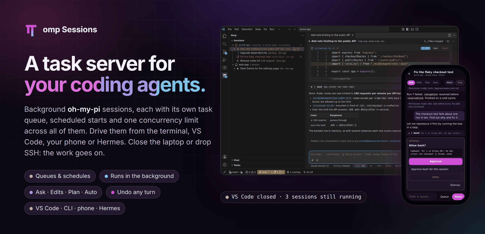

Run [oh-my-pi](https://omp.sh) (`omp`) coding agents in the background, one session per task, and drive them from VS Code, a terminal or your phone. Sessions live in their own process on the machine with your code — your computer, or the server you reach over Remote-SSH — so closing VS Code, sleeping the laptop or dropping SSH doesn't stop them. Come back and everything that happened meanwhile is there: answers, diffs, questions waiting for you.

**[Website](https://mbaradad.github.io/omp-vscode/)** · **[Install](https://marketplace.visualstudio.com/items?itemName=mbaradad.omp-sessions)** · **[Phone app & HTTP API](docs/REMOTE-API.md)** · **[Hermes plugin](docs/HERMES.md)** · **[Changelog](CHANGELOG.md)**

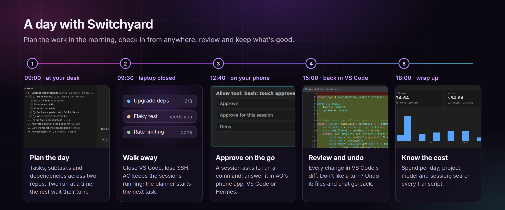

## What people use it for

| Use case | How |
| --- | --- |
| **Long jobs on a remote box** | Start a big refactor over Remote-SSH, close the laptop, reconnect tomorrow to the finished work and the full transcript. |
| **A queue for the day, or the night** | Tasks with subtasks per session, a global "N at a time" limit, scheduled starts (`02:00`, `+2h`). They run with VS Code closed and resume after a reboot. |
| **Several attempts at once** | *Best-of-N* runs the same task in N git worktrees; compare the branches and merge the best one. |
| **Careful work on code that matters** | **Ask** or **Plan** mode, every edit in VS Code's diff editor, and undo for any turn — files and conversation together. |
| **Supervising from anywhere** | The phone app shows what's working, waiting or done; approve a command, steer a session or start a new one from the couch. |
| **Fixing what's in front of you** | *Fix with omp* on a squiggle, on a failed terminal command, or on all of a file's problems; commit messages and PR descriptions from Source Control. |
| **Scripts and automation** | `omp-vs new --task …`, `omp-vs wait … --json`, or the HTTP API from your own tools. |
| **Other agents delegating to omp** | Hermes, Claude Code, Codex or omp itself start, schedule and supervise omp sessions through the `omp-sessions` skill; Hermes gets a plugin with native tools, notifications and a kanban lane that runs cards as omp sessions. |
| **Hands-free** | Talk to a session with omp's realtime voice and watch the transcript land in the chat. |

## Highlights

### A chat that lives in your editor

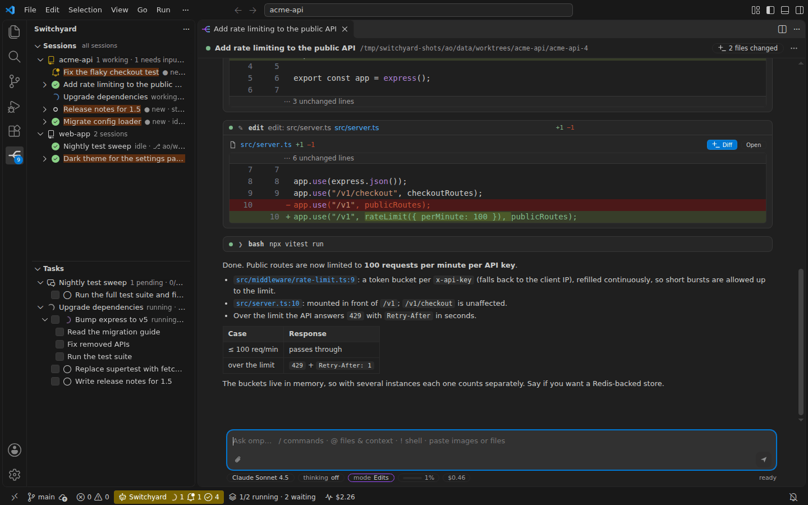

Streaming answers, tool cards with live durations, syntax-highlighted inline diffs, clickable `file:line` links, `@` file mentions, `/` commands, image and file attachments. The footer holds the model picker (star your favorites), thinking level, permission mode, context use, cost, tokens per second and your provider's usage limit. Open it in an editor tab or the side bar, or continue the same session in omp's own terminal UI.

### You decide what runs: permission modes

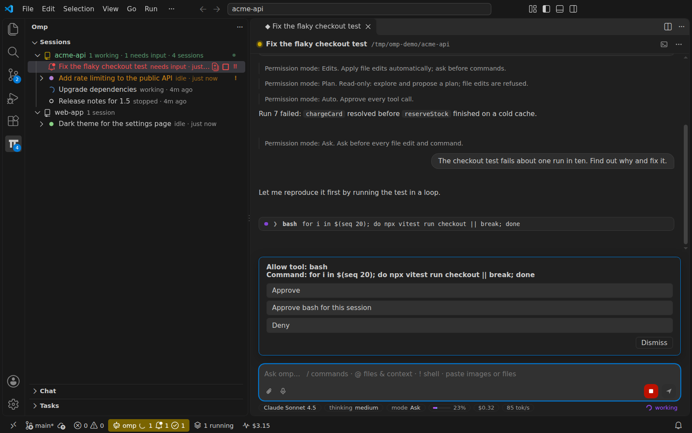

**Ask** approves every edit and command, **Edits** applies file edits and asks before commands, **Plan** is read-only and asks the model for a plan, **Auto** runs everything. Switch any time with **Shift+Tab** — even with an approval already waiting. The session host enforces the mode, so it holds while VS Code is closed.

### Undo any turn

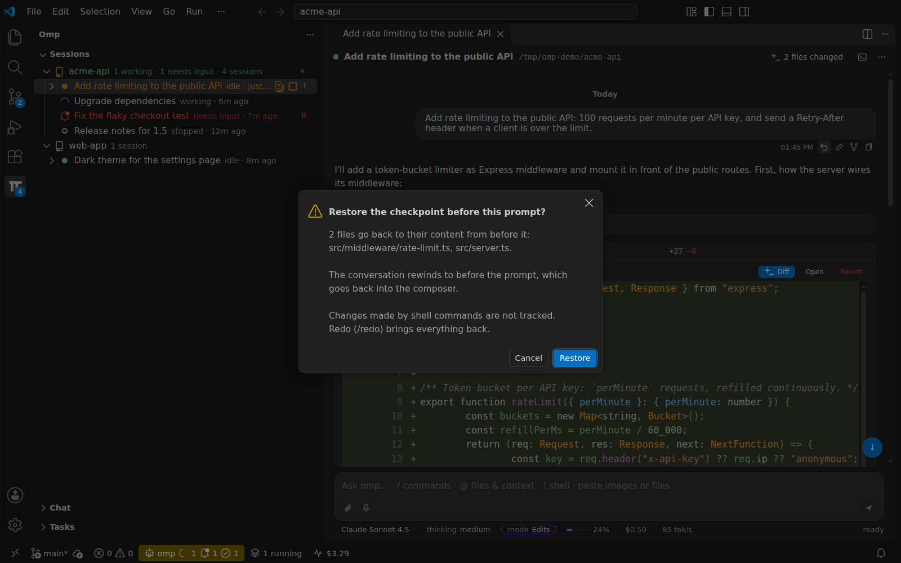

Every prompt is a checkpoint. Undo puts back the files omp changed since then and rewinds the conversation; the prompt returns to the composer so you can rephrase. Redo brings it all back.

### Review every change

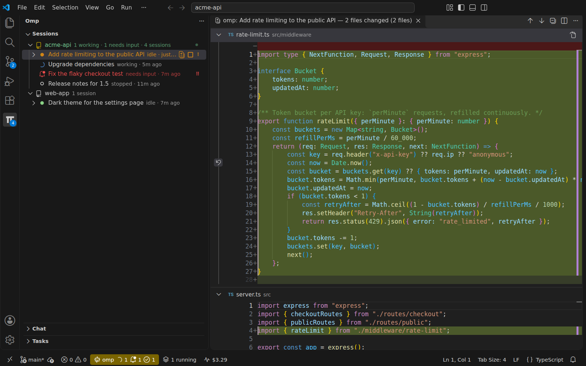

Each session snapshots the files it edits. Review them in VS Code's own diff editor, revert per file or per tool call, and see `π` badges and changed-line markers in the Explorer and open editors.

### Many sessions, one overview

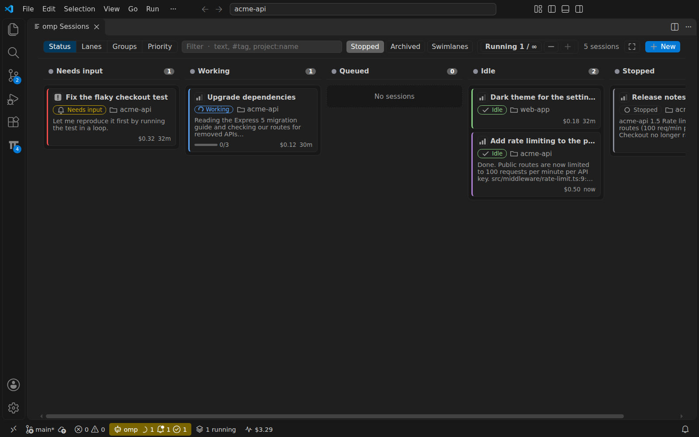

The Sessions view groups sessions by project with working and needs-input counts; the Board shows them as a kanban by status, your own lanes, groups or priority. Groups, colors, priorities, pins, tags and filters keep dozens of sessions manageable. Sessions that finished or asked something while you were away are marked **● new**.

### Task queues that run without you

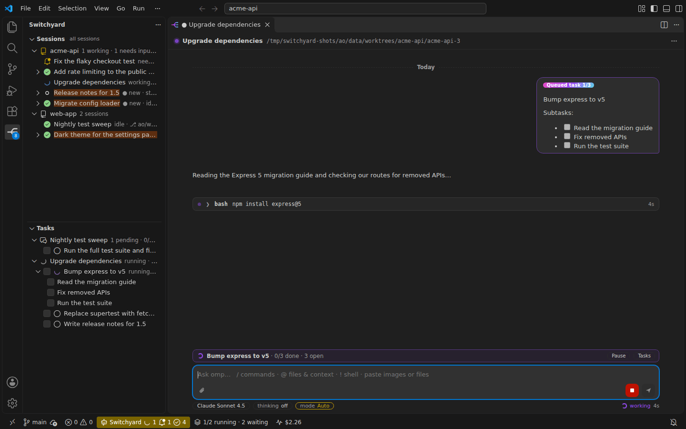

Queue tasks and subtasks per session; the session host feeds them to omp one by one. One limit across all sessions decides how many run at once, and the `omp-vs` server starts queued sessions when a slot frees up — also after a reboot.

### Your phone

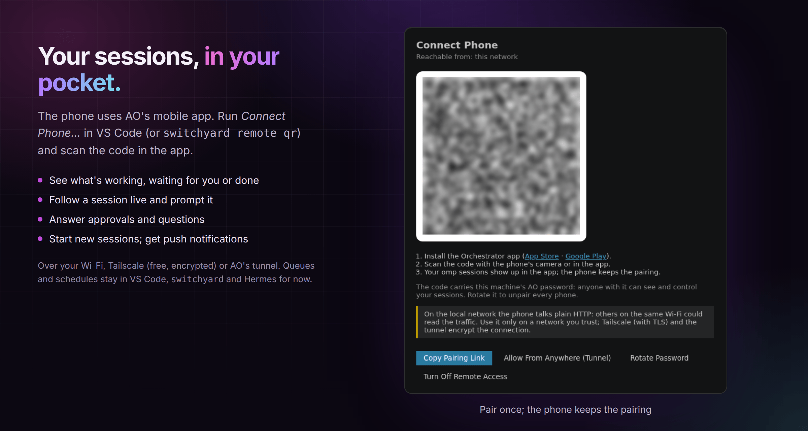

*Connect Phone…* shows a QR code; the `omp-vs` server serves a small web app you can add to your home screen. Follow sessions live, prompt or steer them, answer approvals and questions, switch modes, stop or resume, and start new sessions in a recent folder. Use [Tailscale](https://tailscale.com) (free, encrypted) or your Wi-Fi. The same token-protected JSON + Server-Sent Events API is documented for your own apps: [`docs/REMOTE-API.md`](docs/REMOTE-API.md).

### Know what it costs

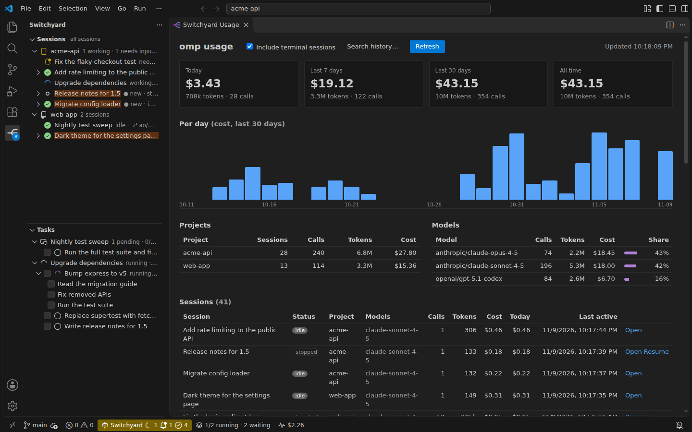

Spend and tokens per day, project, model and session, today's spend in the status bar, and a search across every transcript.

## Get started

1. **Install omp** on the machine where sessions will run (your computer, or the Remote-SSH host) and log in to a model provider: `curl -fsSL https://omp.sh/install | sh`
2. **Install the extension** from the [Marketplace](https://marketplace.visualstudio.com/items?itemName=mbaradad.omp-sessions) (`code --install-extension mbaradad.omp-sessions`). Over Remote-SSH, install it on the SSH host.
3. **Start a session**: open a folder and press `+` in the omp **Sessions** view. `Cmd+Alt+O` focuses the chat; *Help → Get Started → omp: background coding agent* walks through the rest.
4. Optional: *omp: Install omp-vs Command* for the terminal, then `omp-vs server install` so queued work resumes after a reboot; *omp: Connect Phone…* for the phone app.

## How it works

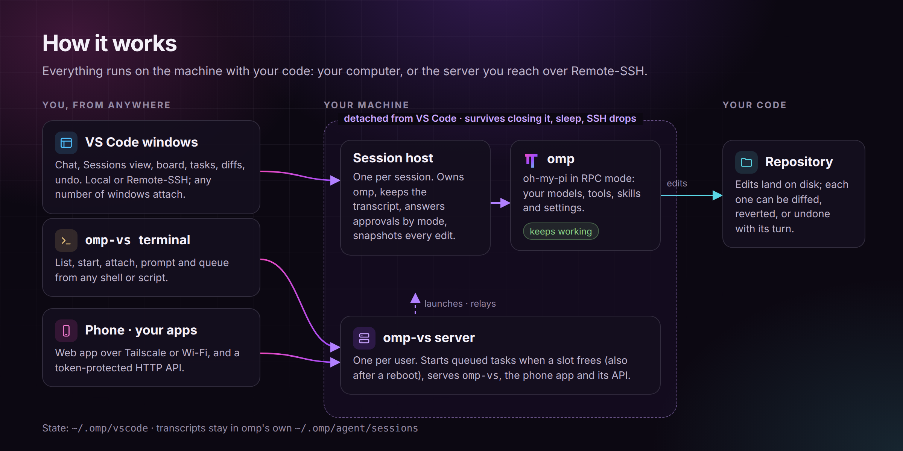

- **Session host** (`out/host.js`, one per session, double-forked so its parent is init) owns the `omp --mode rpc-ui` process, mirrors the transcript, tracks in-flight messages, tools and pending dialogs, answers omp's approval prompts according to the permission mode, and snapshots every file before and after `edit`/`write`/`ast_edit`/`notebook` tool calls into content-addressed blobs. It listens on a Unix socket (`~/.omp/vscode/sessions/<id>/s.sock`); any number of VS Code windows can attach, and late attachers get a full snapshot.
- **Extension** lists sessions (tree view, board, status bar), opens chats (editor tabs or the side bar Chat view), renders diffs from the snapshots, and restores open chats after a reload or reconnect.
- **Task queue** (`queue.json`) belongs to the host, which feeds pending tasks to omp one by one whenever the session is idle — VS Code doesn't need to be open.
- **omp-vs server** (`out/server.js`, one per user, socket `~/.omp/vscode/server.sock`): starts *stopped* sessions whose queue has work when a concurrency slot frees up (by priority and manual order, also after a reboot), stops the sessions it started once their queue is done and nobody is watching, and backs off from sessions that die right after launch. It serves the `omp-vs` terminal command and, when remote access is on, the phone app and its HTTP API. Sessions never depend on it. The extension keeps it running at its own version (`omp.server.autoStart`).
- State lives in `~/.omp/vscode/sessions/<id>/` (`meta.json`, `launch.json`, `queue.json`, `changes.jsonl`, `blobs/`, `attachments/`, `host.log`), plus top-level files under `~/.omp/vscode/`: `organize.json` (groups/colors/priority/pins/tags/lanes), `scheduler.json` (global concurrency) and `slots/` (per-task leases), `launcher.json` (last `omp.path`/`omp.extraArgs`, so terminal launches match VS Code's), `remote.json` (remote access: on/off, bind, port, token; mode `0600`), `runtime/` (host/server/CLI/phone-app copies that survive extension updates), and `server.log`. The omp transcript itself stays in `~/.omp/agent/sessions/`.
- Robustness: one host per session (a second launch exits), stale sockets are replaced, a missing folder or omp binary stops the session with a readable reason, a crashed host shows as stopped and resumes cleanly, malformed client input is ignored.

Works on Linux and macOS, locally and over Remote-SSH (Windows: named pipes and `.cmd` shims are handled, but untested).

## Feature reference

### Sessions

- **Sessions view** groups sessions by project (git repository, else folder) with working / needs-input counts; `+` on a project starts a session there. *Group Sessions By…* switches between project, your groups, status, or a flat list; *Sort Sessions By…* picks the order inside each group. The eye button (*Hide Finished Sessions*) hides stopped sessions; ones with unseen activity stay until you look, and the view header counts how many are hidden. *Open in Side Bar* / *Open in Editor Tab* choose where a chat opens (`omp.chatLocation` sets the default); the **Chat** view can be dragged to the secondary side bar to sit next to your code.
- `+` starts a session in the workspace folder; *New Session with Options…* picks model, thinking level, permission mode, plan-first / advisor / prewalk, an optional **goal**, and any extra omp CLI flags (remembered for resumes).
- **Sessions Board** (*Open Sessions Board*): a kanban of every session — columns by status, by lanes you define (Backlog / To Do / In Progress / Review / Done), by group, or by priority; swimlane mode shows one row per project. Drag cards (or arrow them) to move them; set priority (P to cycle), color, pin, archive and tags per card or in bulk. Cards show queue progress, cost, last text and unread; the header carries the global concurrency counter; *Maximize* fills the panel.
- **Organization**: nest **groups** (each with a color and an icon) and set **color / priority / pin / archive / tags** per session — from the tree (drag, context menus) or the board. The Sessions view filter box accepts free text, `#tag` and `project:name`; manual ordering and group collapse persist in `organize.json`.
- **Git worktrees**: *New Session in Git Worktree…* starts a session in a sibling `<repo>.worktrees` checkout on an `omp/…` branch (any base branch/tag/commit); *Best-of-N* runs the same task in N parallel worktree sessions. Worktrees group under the main repo in the Sessions view; *Compare Branch with Base*, *Merge into Main Checkout…*, *Open in New Window*, *Remove Worktree and Session* (deletes the branch + worktree, keeps the transcript).
- omp questions (`ask`, approvals, selects, inputs) appear as cards above the composer; the session shows **needs input** in the tree/status bar and a notification fires when the chat is not visible. Sessions that finished or asked something while you were away are marked **● new** in the Sessions view and counted on the omp activity-bar badge until you look.
- Stopped sessions keep their transcript; **Resume** restarts omp on the same transcript. *Resume omp Transcript in Background…* adopts any earlier omp session for the folder (e.g. started in a terminal).

### Control and safety

- **Permission modes** — **Ask** (approve every edit and command), **Edits** (file edits apply, commands ask), **Plan** (read-only: edits are refused and prompts ask for a plan), **Auto** (approve everything). Switch live from the footer chip, **Shift+Tab** in the composer, `/mode`, `/plan`, *Set Permission Mode…* in the Sessions view, the phone app, or `omp-vs mode`. The session host answers omp's approval prompts according to the mode (omp runs with `--approval-mode always-ask`), so the mode also holds with VS Code closed, and switching resolves approvals already waiting. A new session starts in omp's `tools.approvalMode` setting, else Auto; the chosen mode is remembered across resumes. Subagents keep omp's own behavior.
- **Checkpoints**: every prompt is a checkpoint. The undo button on a prompt (or *Undo last turn* / `/undo`) rewinds the conversation to before it and puts every file omp's edit tools changed since back the way it was; the prompt returns to the composer. *Redo* / `/redo` brings the conversation and the files back.
- **Diffs**: edit/write cards show a line diff with old/new line numbers and word-level highlights (click a line to jump there); *Diff* opens VS Code's diff editor for that tool call and *Revert* restores the file to its content before that call; *N files changed* / `/changes` opens a multi-file review of everything the session changed.
- **Change markers**: files changed by a running session (or a stopped one in this workspace) get a purple `π` badge in the Explorer; open editors mark lines that differ from the content before the session touched the file, with a CodeLens to diff, **Revert** (also on file nodes in the Sessions view), or open the chat.

### Chat

- Composer: Enter sends, Shift+Enter newline, Esc interrupts, ↑/↓ recall earlier prompts, drafts survive reloads; while the agent works Enter steers (`omp.sendWhileBusy`). `/` completes omp's commands plus the extension's (`/new`, `/resume`, `/tree`, `/fork`, `/goal`, `/btw`, `/agents`, `/changes`, `/mode`, `/plan`, `/undo`, `/redo`, `/voice`, `/tui`, `/copy`, `/cost`, `/login`, `/logout`, `/settings`, `/help`, `/exit`); `@` completes files; `!cmd` runs a shell command in the session. Unsaved editors in the session folder are saved before each prompt so omp reads what you see.
- **Footer**: model picker (star models to pin them on top), thinking level, permission mode, context use, cost, tokens per second and your provider's usage limit when omp reports one.
- Messages: hover a prompt to **edit & resend** (rewinds the conversation to it), **fork** from it, or **restore its checkpoint**; hover an answer to copy it and see model/tokens/cost. Code blocks and diffs are syntax-highlighted with your theme's colors; images open full size on click; tool cards show live durations and the turn's elapsed time is in the footer.
- **Voice** (mic button or `/voice`): talk to the session through omp's realtime voice — live transcript, level meter, mute and end; the transcript lands in the chat. Needs an OpenAI/ChatGPT login in omp, and the audio is captured on the machine omp runs on (so not over Remote-SSH). `omp.voice.name` picks the voice.
- **Terminal UI**: the terminal button in the chat header (or `/tui`, *Continue Session in omp's Terminal UI*) opens the same session in omp's own TUI in an editor tab beside the chat; closing the terminal hands the session back to the background host.
- **Attachments**: paste or drop images (sent to the model as images) and any other file — PDFs, docs, archives — (stored under the session's `attachments/` on the remote and handed to omp's read tool). 📎 picks files on the remote disk.
- **Links**: web URLs open in the browser; `file:`/relative/absolute paths (with `:line` or `#L12`) open in the editor; `artifact://`, `local://`, `skill://`, `omp://`, … open their content.
- **More**: in-chat find, *Copy / Save as Markdown* and *Export as HTML*, `omp.chat.snippets` prompt snippets (`/p:name`, with `{{selection}}` and `{{file}}`), per-message timestamps, and tail-first rendering of long transcripts.

### Queues and scheduling

- **Tasks view**: queue work per session — tasks with subtasks (`Title :: step; step`), drag & drop to reorder (also between sessions), checkboxes to complete, run now / start / pause the queue, edit details, and edit omp's own plan (its todo list). From the chat: `/queue …`, **Alt+Enter** (queue instead of send), and the queue bar above the composer. Queued tasks show up in the transcript as *Queued task i/n*; a failure or an interruption pauses the queue.
- Per-task *Options…* (model, thinking level, fresh context, retries 1–5, timeout), *Duplicate Task*, *Retry Failed Tasks*, and *Schedule Queue Start…* (`HH:MM`, `YYYY-MM-DD HH:MM`, or `+30m/+2h/+3d`). The host applies each task's model/thinking/retries.
- **Concurrency scheduler**: queues across *all* sessions share a limit (`scheduler.json`, enforced by the host via `slots/` leases, so it holds with VS Code closed). The status bar shows `N/M running · K waiting`; *Set Concurrency…*, *Increase/Decrease*, *Pause/Resume Queued Tasks*. A task waiting for a slot shows its queue position in the tree and the board.

### Agents and Hermes

- **The `omp-sessions` skill** teaches other agents to use `omp-vs`: start a session, queue or schedule it (`--task`, `--at`), wait for it (`omp-vs wait --json` exits 0 idle, 3 needs input, 4 stopped), read its report (`omp-vs show --json`: state, waiting question, full last reply), answer its questions (`omp-vs answer`), and follow up. *Install omp Sessions Skill for Agents…* or `omp-vs skill install` puts it in `~/.agents/skills` (omp and other tools), `~/.claude/skills` and `~/.codex/skills`; copies it installed are refreshed when the extension updates.
- **Hermes Agent plugin** (*Install Hermes Plugin…*, `omp-vs hermes install`, or `hermes plugins install mbaradad/omp-vscode/integrations/hermes/omp-sessions --enable`): native `omp_session_*` tools, a message back in the Hermes chat when a session it started finishes or needs input, and a kanban lane: cards assigned to `omp` run as omp sessions in the card's workspace (or the board's folder, grouped by board), with results, questions and failures written back to the card and dependencies chaining as usual. Recurring work goes through Hermes cron. An **omp Sessions** page in the left sidebar of the Hermes dashboard and Hermes Desktop shows every session by state, answers questions, follows up, starts new sessions and sets up the lane per board. Details: [`docs/HERMES.md`](docs/HERMES.md).

  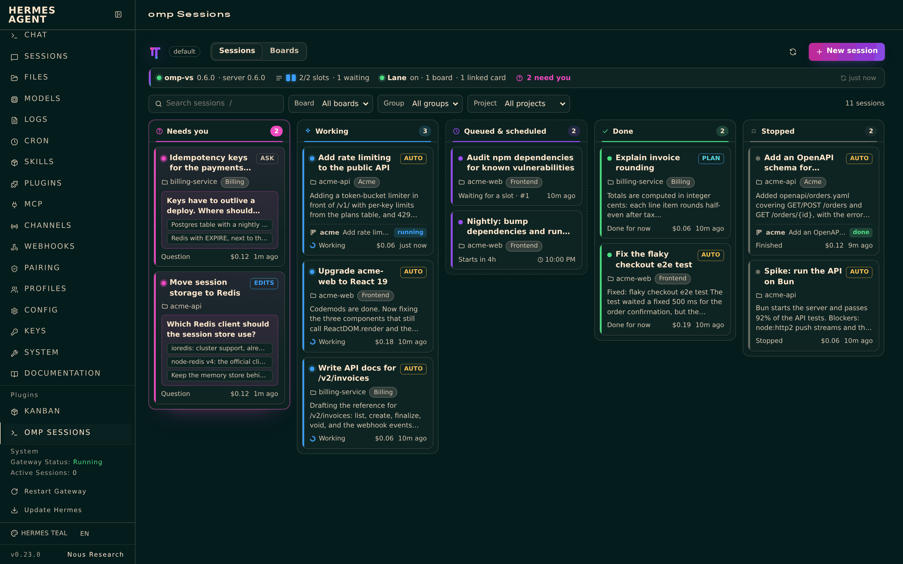
- Agent-friendly CLI: `omp-vs new … --json` (with `--mode`, `--tag`, `--group`, `--notes`, `--at`), `show`, `wait`, `answer`, `projects`, `ls --json` and `sched --json`.

### Phone and remote access

- *Connect Phone…* turns remote access on (Tailscale, local network, or this computer only), makes sure the `omp-vs` server runs, and shows a QR code of the pairing link. The phone app lists every session by status, follows one live, prompts or steers it, answers approvals and questions, switches its permission mode, stops or resumes it, and starts new sessions in a recent folder (or queues them).
- [Tailscale](https://tailscale.com) (free) is recommended: it reaches the machine from anywhere and encrypts the traffic. The local-network option is plain HTTP, readable by anyone on that Wi-Fi. *Disable Remote Access* turns it off; *Rotate Remote Access Token* unpairs every phone.
- The token-authenticated JSON + Server-Sent Events API behind the app is documented for your own apps and servers: [`docs/REMOTE-API.md`](docs/REMOTE-API.md).

### Editor and Git integration

- Select code → `Cmd+Alt+K` (or editor context menu → *Send Selection to omp*) inserts `path:lines` plus the snippet into the composer.
- **Code actions** (lightbulb): *Fix with omp* on problems sends the diagnostics plus a snippet; *Explain with omp* / *Ask omp about this…* on a selection. *Add to omp Chat* (Explorer, editor tab, editor context menu; multi-select, folders too) inserts `@path` references; *Send Terminal Selection to omp* (terminal context menu) inserts selected terminal output.
- **Editor**: *Edit with omp* (`Ctrl/Cmd+Alt+E`) prompts with a file (or your selection) preloaded; *Fix File/Workspace Problems with omp*, *Fix Failed Command with omp* (also offered in the status bar after a terminal error, `omp.terminalHints`), *Write Tests with omp*, *Add Docs with omp*, *Explain File with omp*.
- **Source Control** `…` menu: *Commit with omp* (groups and commits the working tree with good messages), *Review Uncommitted Changes with omp*, *Write PR Description with omp*.
- **VS Code bridge**: a session can call *this window's* language features through a per-session MCP server (`out/mcp.js`) — document symbols/definitions, hover and diagnostics of open files; symbol links in the chat resolve to the right file/line here. *VS Code Bridge: Show Status* reports connected windows and a round-trip probe; *Session Settings…* toggles a session's skills, tools and MCP servers (a tooltip chip appears in the tree when a session is non-default).

### Tools

- **Command Center** (`Ctrl/Cmd+Alt+P`): a searchable, grouped index of every omp command, including omp's own CLI features surfaced as VS Code commands (*Login, Update, Setup, Plugins, Skills, Usage, Stats, Models, Cleanse, Commit in Terminal, Git UI, Continue in Terminal, Import Claude/Codex, Open Docs/Config, Keyboard Shortcuts*).
- **Usage dashboard** (*Usage Dashboard*): cost, tokens and session trends over a range; *Show Today's Spend* in the status bar; *Search Session History…* across every transcript (open the session, resume, or read the raw transcript).
- **Doctor** (*Run Doctor*): a health report — missing omp, auth problems (no API key / not logged in), outdated session hosts, hosts that died mid-turn — each with one-click fixes (*mark stopped*, *resume*, *upgrade host*). *Copy Diagnostics*, *Upgrade Session Host(s)*, *Clean Up File Snapshots*; a crashed session offers *--restore* on resume.
- **Get started**: *Help → Get Started → omp: background coding agent* walks through the features.

## Terminal: `omp-vs`

*omp: Install omp-vs Command* puts `omp-vs` in `~/.local/bin`. It runs on Node 22+ from PATH, else on VS Code's own runtime. The command reaches the same sessions without VS Code: over SSH, from scripts, or after a reboot.

```bash
omp-vs ls                       # running sessions (stopped ones hidden: --all shows them)
omp-vs new . -p "fix the flaky test"          # start a session with a prompt
omp-vs new ~/repo --task "upgrade deps" --sub "bump" --sub "run tests" --priority high
                                # queue-only: the server starts it when a slot is free
omp-vs attach .                 # chat in the terminal; dialogs answer inline; Ctrl-D detaches
omp-vs send fix "also update the docs" --wait  # prompt by title words; stream the reply
omp-vs tail <id> -f             # follow output
omp-vs queue <id> add "write the changelog" --run
omp-vs board                    # waiting / working / needs input / idle
omp-vs mode fix plan            # permission mode: ask | edits | plan | auto (no mode: show it)
omp-vs sched set 2              # at most 2 queued tasks at once, across all sessions
omp-vs server status|log -f|install   # install: systemd user unit / launchd agent
omp-vs remote on|off|status|qr|rotate # phone app + HTTP API (on: --bind tailscale|lan|localhost|<ip> --port n)
omp-vs new ~/repo -p "fix the flaky test" --mode auto --tag ENG-142 --json   # for scripts and agents: prints the id
omp-vs wait <id> --timeout 2h --json   # until idle (0), needs input (3) or stopped (4); prints state + last reply
omp-vs show <id> --json         # state, waiting question, last reply, cost
omp-vs answer <id> 1            # answer the waiting question (option number/text, yes/no, text)
omp-vs skill install            # teach Claude Code / Codex / omp to drive omp-vs (omp-sessions skill)
omp-vs hermes install           # Hermes Agent plugin: tools, notifications, kanban lane
```

Sessions are named by id, id prefix, title words, or `.` (latest in this folder). Commands start the server on demand and restart it when it is older than the CLI. Without it (`OMP_VS_NO_SERVER=1`) they work in-process, but queued stopped sessions wait until someone resumes them. The server stops the sessions it launched once their queue is done (after a minute idle, with no chat or `attach` open, and 10 minutes after anyone last typed in them). `omp-vs sched stop-when-done off` keeps them running. Tasks interrupted by a host crash are never rerun unattended.

## Settings

| Setting | Default | Meaning |
| --- | --- | --- |
| `omp.path` | auto | omp executable (PATH, `~/.local/bin`, `~/.bun/bin`) |
| `omp.extraArgs` | `[]` | Extra CLI args for new sessions, e.g. `["--model","opus"]` |
| `omp.sendWhileBusy` | `steer` | Enter while working: `steer` or `followUp` |
| `omp.panelLocation` | `beside` | Chat column for editor-tab chats |
| `omp.chatLocation` | `editor` | Where clicking a session opens its chat: `editor` or `sidebar` |
| `omp.groupBy` | `project` | Sessions view: `project`, your custom `group`s, `status`, or flat `none` |
| `omp.sortBy` | `auto` | Order within each group: `auto`, `manual`, `activity`, `priority`, `name`, `created`, `cost` |
| `omp.showAllSessions` | `false` | List stopped sessions from other projects |
| `omp.notifications` | `true` | Notify on finish / needs input |
| `omp.saveBeforePrompt` | `true` | Save unsaved editors in the session folder before sending a prompt |
| `omp.showChangeDecorations` | `true` | Explorer badges, changed-line markers and CodeLens for files omp changed |
| `omp.showTodayCost` | `true` | Today's omp spend (from transcripts) in the status bar; hidden on days without model calls |
| `omp.dashboard.includeTerminalSessions` | `false` | Dashboard + today's spend also count omp sessions started outside VS Code (all transcripts under `~/.omp/agent/sessions`) |
| `omp.snapshotRetentionDays` | `14` | Days a stopped session must be unused before *Clean Up File Snapshots* (and the Doctor) offer to delete its blobs |
| `omp.chat.snippets` | `[]` | Prompt snippets offered in the chat composer: `/p:name`, with `{{selection}}` / `{{file}}` |
| `omp.terminalHints` | `true` | After a command fails in a terminal in a running session's folder, offer *omp: fix failed command?* in the status bar (needs VS Code shell integration) |
| `omp.server.autoStart` | `true` | Keep the `omp-vs` server running: it starts queued stopped sessions when slots free up and serves the `omp-vs` command |
| `omp.voice.name` | omp's default | Voice for `/voice` sessions |

## Development

```bash
npm install
npm run watch          # esbuild watch → out/
npm run typecheck
npm test               # unit + session-host integration tests (test:unit / test:host for one suite)
npm run test:e2e:desktop  # real local VS Code (downloaded to .vscode-test/, xvfb if no DISPLAY) against test/fake-omp.mjs
npm run install-local  # production build → dist/omp-sessions-<version>.vsix → installed into ~/.vscode-server
```

- **F5** (*Run Extension*) opens an Extension Development Host with this checkout loaded; over Remote-SSH it runs on the remote like the installed copy. *Run Extension (isolated session state)* uses `.dev-state/` instead of `~/.omp/vscode`, so experiments don't touch your real sessions.
- Session hosts already running keep the code they started with. After changing `src/host`, stop + resume a session to pick up the new host.
- Layout: `src/host` (detached session host), `src/ext` (extension), `src/webview` (chat UI), `src/kanban` (Sessions Board), `src/server` (omp-vs server and its HTTP API), `src/mobile` (phone app), `src/cli` (`omp-vs`), `src/shared` (wire contracts). `media/icon.svg` is the source of `media/icon.png`.
- Tests: `npm test` bundles the session host and the TypeScript tests into `.test-out/` with esbuild and runs them with `node --test` (~10 s). Unit tests cover `src/shared` (diff, task queue) and pure webview helpers; host tests launch the real host (`--daemonize`) in a temp `OMP_VSCODE_HOME` against `test/fake-omp.mjs`, a scripted stand-in for `omp --mode rpc-ui` that never calls a model. Its prompts are commands — `echo <text>`, `write <path> <content>`, `edit <path> <old> => <new>`, `ask`, `slow <ms>`, `fail [msg]`, `/<cmd>` — documented at the top of the file. `test:e2e:desktop` drives a real desktop VS Code (local, Electron extension host) through the extension's commands and checks that sessions outlive VS Code.

## Publishing

1. Bump `version` in `package.json` and add a `## <version>` section to `CHANGELOG.md`.
2. `git tag v<version> && git push origin main v<version>`: the Release workflow runs the tests, packages the VSIX, publishes to the VS Code Marketplace via Trusted Publishing (GitHub OIDC, no stored token) and to Open VSX (`OVSX_PAT` secret), and opens a GitHub release with the VSIX attached.

One-time setup (publisher, Trusted Publishing policy, Open VSX namespace, screenshots) is in [`docs/PUBLISHING.md`](docs/PUBLISHING.md). All of it is free.

## Limits

- File changes made through `bash` (e.g. `sed -i`, codegen) are not snapshotted; only omp's file-editing tools are. Checkpoints and *Revert* therefore don't undo them.
- Plan mode is enforced by the extension (edits refused, prompts ask for a plan); omp's terminal-only `/plan` workflow is not exposed over its RPC protocol. *New Session with Options… → Plan first* (`--plan-yolo`) still starts one.
- Voice and the Terminal UI need omp on the same machine as your microphone / VS Code window's terminal.
- A machine reboot stops sessions; their transcripts remain resumable. Queued work restarts once the `omp-vs` server runs again (`omp-vs server install` starts it at login).
