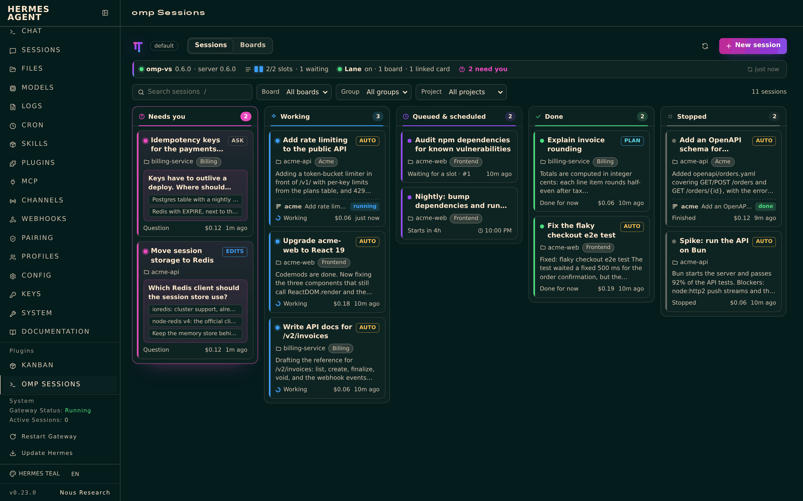
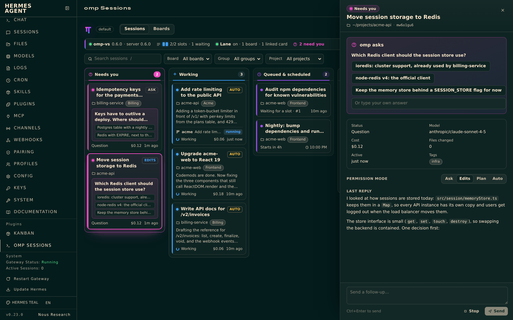

# Hermes Agent: the omp-sessions plugin

[Hermes Agent](https://github.com/NousResearch/hermes-agent) can hand coding work to omp. The `omp-sessions` Hermes plugin gives it:

- **Tools** (toolset `omp_sessions`) to start, queue, schedule, check, wait on, answer, steer and stop omp sessions.
- **Notifications.** When an omp session that a Hermes session started finishes or needs input, Hermes gets a message about it in that session, so it doesn't have to poll.
- **A kanban lane.** Kanban cards assigned to `omp` run as omp sessions, and their outcome goes back to the card. Hermes's dependency chaining works as usual: a child card starts when its parents are done, with their results in its prompt.
- The **`omp-sessions` skill**, plus `/omp` in chats and `hermes omp …` in a terminal.

The plugin drives the `omp-vs` CLI, so every session it starts is an ordinary omp session. You can watch and steer it in VS Code (omp Sessions), with `omp-vs attach`, or in the omp phone app. Queued sessions respect omp's global concurrency limit (`omp-vs sched set <n>`).

## Install

You need `omp-vs` (VS Code: **omp: Install omp-vs Command**) and Hermes Agent 0.23 or later. Install the plugin either from omp-vs or with Hermes's own plugin installer.

**From omp-vs** (the copy that ships with the extension, always matching your `omp-vs`):

```sh
omp-vs hermes install     # copy the plugin into $HERMES_HOME/plugins (default ~/.hermes) and enable it
omp-vs hermes status      # per profile: installed, current or outdated, enabled, lane on or off
omp-vs hermes uninstall
```

**From Git**, with Hermes (it fetches only the plugin folder of this repository):

```sh
hermes plugins install mbaradad/omp-vscode/integrations/hermes/omp-sessions --enable
hermes config set plugins.entries.omp-sessions.allow_gateway_injection true
hermes plugins update omp-sessions      # later, to update
```

Add `-p <profile>` (`hermes -p <profile> plugins install …`) for other profiles. Once the plugin is listed in the [Hermes plugin catalog](https://hermes-agent.nousresearch.com/docs/plugins), `hermes plugins install omp-sessions` installs the reviewed version by name.

`install` copies the plugin to `<home>/plugins/omp-sessions/` and runs these two commands against that profile:

- `hermes plugins enable omp-sessions`
- `hermes config set plugins.entries.omp-sessions.allow_gateway_injection true` (this lets the plugin message Hermes sessions)

A running gateway loads a plugin as soon as it is enabled. The tools then appear in new Hermes sessions. If `hermes plugins list` shows the plugin as enabled but the tools are missing, restart the gateway with `hermes gateway restart`. Rerun `omp-vs hermes install` after updating the extension to update the plugin. A plugin folder that omp-vs didn't install is only replaced with `--force`.

### Profiles

Hermes plugins are installed and enabled per profile. Each profile is a Hermes home with its own `config.yaml`, `plugins/` and plugin settings. Every `omp-vs hermes` command takes the same profile flags:

| Flags | Homes |
| --- | --- |
| (none) | `$HERMES_HOME`, else `~/.hermes` (the default profile) |
| `--profile <name>` (repeatable) | `~/.hermes/profiles/<name>` (`default` is `~/.hermes` itself). The `hermes` steps run as `hermes -p <name> …`. |
| `--all-profiles` | the default profile and every named profile |

```sh
omp-vs hermes install --profile lightscale --profile lightscale-zynq-prototyper
omp-vs hermes status --all-profiles
```

Only real profiles are accepted. Like Hermes, omp-vs counts a folder under `profiles/` as a profile when it has one of `config.yaml`, `.env`, `SOUL.md`, `profile.yaml`, `auth.json` or `state.db`, and `hermes profile delete` hasn't removed it. Folders that only logs or cron created are skipped.

**omp: Install Hermes Plugin…** in VS Code first asks what to do (install or update, show status, uninstall), then which profiles to apply it to. For install, it pre-selects the default profile plus any profile whose `config.yaml` sets `kanban: dispatch_in_gateway: true`. It then shows each profile's status, and `hermes omp status` for profiles where the lane is on.

Install the plugin in the profiles you chat with: tools and notifications work in the profile whose session calls them. **Turn the kanban lane on in one profile only.** That is the profile whose gateway runs the kanban dispatcher, and its lane settings (boards, folders, modes) are the ones that apply.

## Tools

| Tool | What it does |
| --- | --- |
| `omp_sessions_list` | Lists sessions: running and queued, or all with `all: true`. |
| `omp_projects_list` | Lists where sessions can run: recent omp folders, kanban boards with their configured folders and groups, and Hermes projects. |
| `omp_session_start` | Starts a session now (`prompt`) or queues one (`task`, with optional `notes` and `subtasks`). `at` schedules a queued task (`+30m`, `14:30`, an ISO time). Where it runs is set by `cwd`, `project` (a Hermes project, or the name of a known folder) or `board` (that board's folder and group). Also takes `title`, `mode` (`ask`, `edits`, `plan`, `auto`), `group` and `tags`. |
| `omp_session_status` | Returns a session's state, pending question, last reply, queue, cost and changed files. |
| `omp_session_wait` | Blocks until the session is idle, needs input or stops. The default timeout is 300 s, at most 600 s. |
| `omp_session_send` | Sends a prompt. While the session works this steers it; `follow_up: true` queues the prompt for after the current turn. |
| `omp_session_answer` | Answers the waiting question with an option number or text, yes/no, or free text. |
| `omp_session_mode` | Switches the permission mode live. |
| `omp_session_stop` | Stops the session. Its history stays, and `omp_session_send` resumes it. |

States: `queued` (waiting for a slot or its start time), `starting`, `working`, `needs_input`, `idle` (done for now), `stopped`.

## Notifications

`omp_session_start`, `omp_session_send` and `omp_session_answer` remember which Hermes session called them. Once that omp session settles (idle, needs input or stopped), the plugin queues a short message into the Hermes session. The message gives the title, the state, a reply excerpt or the question, and `omp-vs show <id>`. An idle Hermes session starts a turn on it; a busy one gets it after its current turn. If the agent already saw that state through `omp_session_status` or `omp_session_wait`, no message is sent.

Notifications need:

- a running Hermes gateway (Hermes 0.23 runs every session in it);
- `plugins.entries.omp-sessions.allow_gateway_injection: true` (`omp-vs hermes install` sets it);
- the gateway's kanban dispatcher. The plugin checks sessions on its tick, every 60 s by default (`kanban.dispatch_interval_seconds`).

Turn notifications off with `hermes omp notify off`.

## Kanban lane

Hermes's dispatcher only spawns workers for cards assigned to a Hermes profile. A card assigned to anything else (here, `omp`) stays `ready`, and the dispatcher logs `skipped_nonspawnable`. On every dispatcher tick, the lane:

1. **Claims** ready cards assigned to `omp`, using Hermes's kanban API with a claim lock `<host>:omp-sessions`. It only takes cards while omp has free concurrency slots (`omp-vs sched`), at most 4 per tick.
2. **Prepares the workspace** the way Hermes prepares one for its own workers:
   - `worktree`: a git worktree on the card's branch (default `wt/<card id>`), recorded on the card;
   - `dir`: that folder;
   - `scratch`: the folder of the card's Hermes project, else the board's configured `folder`, else Hermes's scratch folder.
3. **Queues an omp session** there. The title is the card title. The task notes hold:
   - a note that the session works on card `<board>/<id>` and that the lane reports back on its own, so the agent needs no kanban tools;
   - the card's worker context exactly as Hermes builds it for its own workers (body, parent results, comments);
   - the paths of the `SKILL.md` files the card asks for.

   The session gets the tags `hermes`, `hermes:<board>` and `card:<id>`, goes into the board's omp group, and starts in the board's permission mode, if one is set.
4. **Comments** on the card with the session id and how to watch it: VS Code, `omp-vs attach <id>`, or the phone app.
5. **Tracks** the session and mirrors it onto the card:

| Session | Card |
| --- | --- |
| queued or working | The claim is renewed every tick, and a heartbeat is recorded every 10 minutes. |
| waiting on a question or approval | `block --kind needs_input` with the question and how to answer it. Once the session moves on, the card is unblocked and claimed again. |
| task done (idle, or stopped afterwards) | `complete`. The result is the session's last reply, and so is the run summary that child cards read. The metadata holds the omp session id, folder, cost and changed-file count. |
| task failed, session stopped early, or session removed | `block --kind transient` with the reason. |
| card done, archived, deleted or reassigned | The lane stops tracking it and leaves the session alone. |

Unblocking a card that failed (in Hermes: `hermes kanban unblock <id>`) retries it in the same omp session, or in a new one if the session was removed.

The card↔session links and the lane's lock live beside the kanban boards, which every profile shares: `~/.hermes/plugin-data/omp-sessions-lane/` (`state.json`, `lane.lock`). Before it creates a session, the lane also looks for an omp session tagged `card:<id>`. A card never gets two sessions, even across restarts or crashes.

### Several profiles

The plugin may be enabled in several profiles, and their gateways may each tick the dispatcher. This is what the plugin guarantees:

- **One lane pass at a time on the machine.** A lane pass takes `lane.lock` with an exclusive file lock (`flock`) and skips the tick if another process holds it. Whichever profile ticks next does the next pass. On Windows, the lock only works within one process.
- **Shared links.** Every profile reads and writes the same links. A card claimed in one profile is tracked and finished from any of them, and is never started twice.
- **A card keeps the assignee it was claimed for.** If another profile's lane settings name a different assignee, that doesn't make the lane drop the card.
- **New cards follow the settings of whichever profile has its lane on.** A profile whose lane is off claims nothing, but it still reports on cards that are already linked.

The lane is off by default. Turn it on in one profile (`hermes -p <name> omp lane on`). `omp-vs hermes status --all-profiles` warns when it is on in more than one, and `hermes omp status` shows where the shared state lives.

### Assign cards to omp

```sh
hermes kanban --board lightscale create "Fix the flaky upload test" --assignee omp --body "…"
hermes kanban --board lightscale create "Release notes" --assignee omp --parent t_1234abcd   # starts when the parent is done
hermes kanban --board lightscale create "Refactor" --assignee omp --workspace worktree --branch refactor/x
hermes kanban --board lightscale assign t_1234abcd omp      # an existing card (not while it is running)
```

`--board` goes before the verb. A card without parents starts `ready`; with open parents it waits in `todo` until they are done.

### Turn it on and configure it

```sh
hermes omp lane on                                   # every board, assignee omp
hermes omp lane on --board lightscale --mode edits   # only these boards (repeat --board); starting permission mode
hermes omp board lightscale --folder ~/src/lightscale --group Lightscale --mode ask
hermes omp project lightscale ~/src/lightscale       # folder for a Hermes project, by id, slug or name
hermes omp lane off                                  # stop taking new cards; linked cards keep reporting
hermes omp lane run                                  # one pass now
hermes omp status                                    # lane, last passes, errors, linked cards and their sessions
```

The settings live in Hermes's `config.yaml`:

```yaml
plugins:
  entries:
    omp-sessions:
      allow_gateway_injection: true
      settings:
        omp_vs: /path/to/omp-vs        # default: PATH, then ~/.local/bin/omp-vs
        notify: true
        lane:
          enabled: true
          assignee: omp
          mode: edits                  # unset: omp's default
          boards:                      # empty: every board
            lightscale:
              folder: /home/me/src/lightscale
              group: Lightscale        # default: the board's name
              mode: ask
        projects:
          lightscale: /home/me/src/lightscale
```

### Answering a card's question

When a card is blocked with `needs_input`, answer the omp session in any of these places:

- VS Code (the session's chat);
- the omp phone app;
- `omp-vs answer <id> <choice>`;
- from Hermes, with `omp_session_answer`.

On its next tick the lane unblocks and reclaims the card.

### Limits

- The lane runs where the dispatcher ticks: the gateway's embedded dispatcher (`kanban.dispatch_in_gateway`, on by default, every 60 s), `hermes kanban dispatch`, or `hermes omp lane run`. Without any of them, cards wait in `ready`.
- Hermes sends a card to `triage` when it is blocked twice for the same reason (its unblock-loop guard), and nothing can complete a card in triage. So only the first question on a card blocks it; later questions are added as comments, and the omp session still waits for an answer.
- A failed card that fails again after a retry goes to `triage` for the same reason.
- `max_runtime_seconds` is not enforced for omp cards. The omp session runs until it finishes. Give the queued task a time limit in omp if you need one.
- When a card completes, Hermes removes its scratch folder, and its worktree too if the worktree is clean and pushed. The omp session's folder may then be gone. Its transcript stays.
- A card whose task the user interrupted (the queue is paused) stays `running` until the task is resumed or the card is completed by hand.
- `review` cards assigned to omp are not picked up.

## Several boards, projects and folders

- Give each board a `folder` and a `group`. Card sessions for that board run there, and VS Code and the omp board show them grouped.
- A Hermes project's cards already run in worktrees of the project's repository, because Hermes sets that up when the card is created. For project cards with a scratch workspace, the lane uses `projects` from the settings, then the project's primary folder.
- `omp_projects_list` shows all of these, so Hermes can pick `cwd`, `project` or `board` for `omp_session_start`.

## Recurring work

Schedules belong to Hermes cron. A cron job can queue an omp session directly:

```sh
hermes cron create "0 7 * * 1-5" "Use omp_session_start with project lightscale and task 'Run the full test suite and fix what fails'. Report the session id." --name omp-nightly-tests
```

Or it can create a kanban card for omp, which keeps the history on the board:

```sh
hermes cron create "every 1d" "Create a kanban card on board lightscale, assigned to omp, titled 'Update dependencies and run the tests'." --name omp-deps
```

For a one-off later start, `omp_session_start` with `task` and `at` (e.g. `"at": "22:00"`) is enough.

## Dashboard and Desktop

The plugin adds an **omp Sessions** page to the left sidebar of the Hermes web dashboard (`hermes dashboard`, next to Kanban) and of Hermes Desktop.



- **Status strip:** `omp-vs` and its server, omp's concurrency slots (running, waiting, limit), the kanban lane, and how many sessions need you.
- **Session board** with five columns: Needs you, Working, Queued & scheduled, Done, Stopped. A card shows the title, project folder, group, permission mode, cost, when it was last active (or when it starts), the linked kanban card with its status, and the question or the start of the last reply. Filter by board, group or project, or search (`/`).
- **Detail panel** (click a card): the question with one button per answer, the full last reply, a follow-up box (it steers a working session, or queues the text after the turn), the permission mode switch, and Stop.
- **New session** (`N`): the prompt, a title, where it runs (a recent folder, a Hermes project, any folder, or a kanban board's folder and group), mode, group, tags, and when: now, queued for a free slot, or scheduled (`+30m`, `22:00`, a date and time).
- **Boards:** the lane switch, and per board the lane's folder, omp group, mode and assignee, the cards it runs as omp sessions with their status, and the ready cards it takes next.



The page refreshes every few seconds while it is visible. Lane settings it changes are the active profile's, like `hermes omp lane` and `hermes omp board`.

What it takes:

- **Dashboard:** the plugin must be enabled (`hermes plugins enable omp-sessions`; `omp-vs hermes install` does it). Hermes mounts the page's backend (`dashboard/plugin_api.py`, under `/api/plugins/omp-sessions/`) when the dashboard or gateway starts, so restart it after enabling (`hermes gateway restart`, or restart `hermes dashboard`).
- **Desktop:** the desktop half (`desktop/plugin.js`) ships off. Turn on **omp Sessions** in **Capabilities → Plugins** (use **Rescan** there if it isn't listed). It uses the same backend, so the plugin must also be enabled in that profile.

The page is built from `integrations/hermes/ui` by `node build.mjs` into `dashboard/dist/` and `desktop/plugin.js`; those files are committed because Hermes installs the plugin folder without a build step.

## Troubleshooting

- **`hermes omp status` says `omp-vs: NOT FOUND`.** Install the command from VS Code (**omp: Install omp-vs Command**), or set `plugins.entries.omp-sessions.settings.omp_vs` to its path. The gateway may run with a smaller `PATH` than your shell.
- **The tools are missing in Hermes.** Check `hermes plugins list`. A user plugin loads only once it is enabled. Start a new Hermes session after enabling, or run `hermes gateway restart`.
- **No notifications arrive.** Check that `allow_gateway_injection` is true (`hermes omp status` warns otherwise), that the gateway is running, and that its kanban dispatcher is on.
- **Cards stay `ready`.**
  - Is the lane on, and is the board in its list? Check with `hermes omp status`.
  - Is the card assigned exactly to the lane's assignee?
  - Is omp's concurrency limit full (`omp-vs sched`)?
  - Is the dispatcher ticking? `hermes omp lane run` forces a pass.
- **A card was blocked with "could not prepare the workspace".** A `worktree` card needs a path inside a git repository, or a board `default_workdir`. A `dir` path must be absolute.
- **Logs.** Lane and notification errors are written to Hermes's log (`~/.hermes/logs/agent.log`) and shown by `hermes omp status`. omp's own logs: `omp-vs server log` and `omp-vs tail <id>`.
