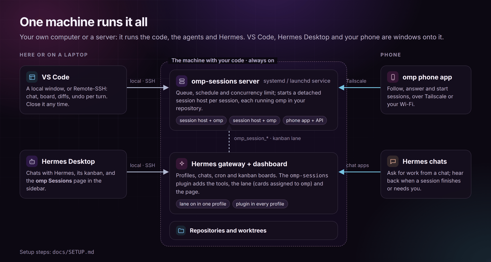

# Setting up omp Sessions, Hermes and your phone

omp Sessions works the same whether everything runs on the computer in front of you or on a workstation or server you reach over SSH. This guide covers both, with Hermes Agent and the phone app as optional extras. Pick the arrangement that matches yours; the steps are the same, only *where* they run changes.



| Arrangement | The machine with the code runs | You work from |
| --- | --- | --- |
| **Local**: one computer (Linux or macOS) | everything below | the same computer, plus your phone |
| **Remote**: a workstation or server | everything below | a laptop (the `omp-sessions` command over SSH, VS Code Remote-SSH, Hermes Desktop in remote mode) and your phone |

**Windows**: run omp, the server and Hermes in WSL 2 and use VS Code through a *WSL* window; for the phone, run Tailscale on Windows (see [step 3](#3-your-phone-optional)). Native Windows is handled but untested: there is no login service (the server starts on demand), the command lives in `%LOCALAPPDATA%\omp-sessions`, and Hermes's home is `%LOCALAPPDATA%\hermes`.

"The machine" below means the computer with your repositories: your own computer in the local arrangement, the workstation or server in the remote one. omp, the `omp-sessions` server, every session, Hermes and the plugin all run there, so closing the laptop or losing signal never stops work.

## 1. omp Sessions

1. **omp** on the machine: `curl -fsSL https://omp.sh/install | sh`, then sign in to a model provider (run `omp`, then `/login`).
2. **omp Sessions**, one of:
   - **The VS Code extension**: install **omp Sessions** in VS Code. Remote: connect VS Code to the machine with Remote-SSH (or WSL, or a dev container) first; the Extensions view installs it on that side, which is where it runs. Then run **omp: Install omp-sessions Command** for the terminal command.
   - **Only the command** (a headless server, or no VS Code): with Node 22+, `npm install -g https://github.com/mbaradad/omp-sessions/releases/download/v<version>/omp-sessions-<version>.tgz` (the asset of each [release](https://github.com/mbaradad/omp-sessions/releases)).
3. **Check it**, in a terminal on the machine:
   ```sh
   omp-sessions status          # server, login service, omp, default model, sessions, problems (exit 1 if any)
   omp-sessions config set model anthropic/claude-sonnet-4-5   # optional: default model of new sessions (one `omp-sessions models` lists)
   ```
   The first command that needs the server starts it and installs it as a login service once (a systemd user unit on Linux, a launchd agent on macOS), so it comes back after a crash or reboot; restarts from VS Code or the CLI go through systemd or launchd. It needs Node 22+ on PATH: with only VS Code's own runtime (as over Remote-SSH without Node installed), the server still starts on demand but isn't installed as a service, and `omp-sessions status` says why. A service whose Node or `server.js` moved is rewritten by the next command or VS Code start. `omp-sessions server install` does it by hand, `omp-sessions config set service off` stops it from happening by itself, `omp-sessions server uninstall` removes it. On a Linux server, `loginctl enable-linger $USER` keeps user services running without a login session; WSL needs systemd enabled in `/etc/wsl.conf`.

   Upgrading from 0.5.0, where the command was `omp-vs`: the extension, or `omp-sessions server install`, replaces the old launcher and service (`omp-vs.service`, `dev.omp.vs-server`) with the `omp-sessions` ones automatically, and running sessions keep going. On Windows, add `%LOCALAPPDATA%\omp-sessions` to PATH.

That is all omp Sessions needs. The rest is optional.

## 2. Hermes Agent (optional)

1. **Hermes** on the same machine, with its gateway running as a service (`hermes gateway install`). Run the web dashboard too (`hermes dashboard`) if you want the browser page or Hermes Desktop in remote mode.
2. **The plugin**, in every profile you chat with: **omp: Install Hermes Plugin…** in VS Code, or
   ```sh
   omp-sessions hermes install --all-profiles
   omp-sessions hermes status --all-profiles
   ```
   `HERMES_HOME` is respected. The gateway loads the plugin without a restart; restart the dashboard once so it mounts the page's backend. When the extension updates, it refreshes the plugin and reloads it in the running gateway. Without VS Code, install it from Git instead: `hermes plugins install mbaradad/omp-sessions/integrations/hermes/omp-sessions --enable` (it still needs `omp-sessions` on the machine). Comments on kanban cards reach omp only from trusted authors (`lane.comment_authors`, default `dashboard`, which covers the dashboard and Hermes Console).
3. **The kanban lane**, in one profile: the one whose gateway runs the machine's kanban dispatcher. With a single multiplexed gateway that is `default`; with one gateway per profile, it is whichever gateway took the dispatcher lock. `hermes omp status` tells you which (`kanban dispatcher: last tick … in profile …`) and warns when the lane is on elsewhere.
   ```sh
   hermes -p default omp lane on --board <board>
   hermes -p default omp board <board> --folder ~/projects/<project> --mode auto
   hermes -p default omp status
   ```
4. **The skill for other agents**: **omp: Install omp Sessions Skill for Agents…** or `omp-sessions skill install`, so omp, Claude Code and Codex on the machine can hand work to background sessions too.

### The omp Sessions page in Hermes

| Where you open Hermes | How the page gets there |
| --- | --- |
| **Web dashboard** (any browser) | Automatic once the plugin is enabled and the dashboard restarted: **omp Sessions** appears under *Plugins* in the sidebar. |
| **Hermes Desktop, local mode** (Hermes on this computer) | Desktop copies the page from the installed plugin. Turn **omp Sessions** on in *Capabilities → Plugins* (use **Rescan** if it isn't listed). |
| **Hermes Desktop, remote mode** (an SSH gateway or a remote URL) | Desktop plugins live on the computer running Desktop, so add the page there once: *Capabilities → Plugins → Install from Git*, repository `mbaradad/omp-sessions/integrations/hermes/omp-sessions`. The agent part is already on the machine, so Desktop reports that it exists and installs only the page. Then turn it on. |

The page always talks to the plugin on the machine Hermes runs on, so it shows that machine's sessions. After a plugin update, Desktop keeps its copy of the page until you **Rescan** (local) or **Install from Git** again with **Force reinstall** (remote); the page tells you when it is older than the plugin.

## 3. Your phone (optional)

- **omp phone app**: **omp: Connect Phone…** (or `omp-sessions remote on` and `omp-sessions remote qr`) and scan the QR code. How the phone reaches the machine:
  - **Tailscale on the machine** (recommended): pick *Tailscale*. Install Tailscale on the phone too, same account.
  - **Tailscale on Windows, omp in WSL 2**: pick *Behind Tailscale Serve or an HTTPS proxy*, run `tailscale serve --bg 7413` in a Windows terminal and enter the `https://<machine>.<tailnet>.ts.net` address it prints. The same option works with any HTTPS reverse proxy you run.
  - **No Tailscale**: *Local network* (plain HTTP; only on a Wi-Fi you trust).
  
  Details: [Remote access](REMOTE-API.md).
- **Hermes**: talk to it from its messaging channels, Hermes Desktop, or [Hermes Console](https://github.com/xP3ta/hermes-console) on Android. Asking for coding work starts omp sessions, and the chat hears back when they finish or need you. In any chat, `/omp` says what needs you and `/omp take <card>` hands a kanban card to omp ([details](HERMES.md#hermes-console-android)).

## 4. The laptop, in the remote arrangement

- **Terminal**: `ssh` to the machine and use `omp-sessions` (`status`, `ls`, `attach`, …). `omp-sessions vscode <session>` prints a link that opens the session in VS Code on the laptop.
- **VS Code**: Remote-SSH to the machine. Every window attaches to the same sessions; close it whenever you like. A window lists this workspace's sessions by default; *Show All Sessions* in the Sessions view title lists every session on the machine. Links the extension opens on the machine's `localhost` (the phone app's *Open in Browser*, *Open Hermes Card*) are forwarded to your laptop by VS Code.
- **Hermes Desktop**: connect it to the machine's Hermes, as an **SSH** gateway (*Settings → Gateways → Add → SSH*) or a **Remote gateway** URL (with Tailscale, or an SSH tunnel: `ssh -N -L 9119:localhost:9119 <machine>`). Then add the page as in the table above.
- **Voice** uses the microphone of the machine omp runs on, so it works in local windows only.

## A day with this setup

1. **Plan in Hermes.** Talk the work through, from Desktop, the dashboard or a chat. Hermes files kanban cards with dependencies, assigned to `omp`, or starts and schedules sessions directly (`omp_session_start`, with `at` for later).
2. **omp does the coding.** The lane turns ready cards into omp sessions in the card's worktree, one group per board, within omp's concurrency limit (`omp-sessions sched set <n>`).
3. **Answer questions anywhere.** A session that needs you shows up on the omp Sessions page in Hermes, on the phone, in VS Code, in `omp-sessions ls`, and as a message in the chat that started it. Answering in one place answers it everywhere. Approvals are yours: comments and the Hermes agent can't answer them (unless you turn on `agent_approvals`).
4. **Review in VS Code.** *Open project in VS Code* on the Hermes page (or `omp-sessions vscode <session>`) brings it up; diffs, checkpoints and undo per turn. The card gets the session's final reply, and dependent cards start.

If the machine reboots overnight, the server comes back with it and starts queued work that hadn't begun. A task that was running is marked *interrupted*, and its card is blocked until you unblock it.

## Check that it all works

| Check | Command (on the machine) | Healthy |
| --- | --- | --- |
| Machine | `omp-sessions status` | exit 0: the server runs, omp is found, no problems listed |
| Server supervised | `systemctl --user is-active omp-sessions` or `launchctl print gui/$UID/dev.omp.sessions-server` | active / running |
| Plugin everywhere | `omp-sessions hermes status --all-profiles` | every profile `current, enabled`, the lane on in one |
| Lane reachable | `hermes -p <profile> omp status` | a dispatcher tick in the last minute, no `!` lines |
| Extension health | **omp: Run Doctor** in VS Code | no problems in the Hermes section |
| Hermes page | the dashboard or Desktop sidebar | **omp Sessions** listed and showing your sessions |
| Phone | `omp-sessions remote status` | `on`, with the URL you pair with |

When something is off, start with `omp-sessions status`, `hermes omp status` and **omp: Run Doctor**; [the Hermes guide](HERMES.md#troubleshooting) lists the usual causes.
