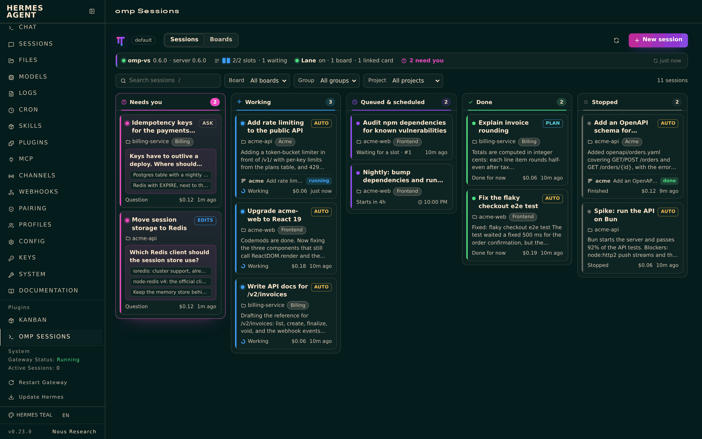

# omp-sessions: omp coding sessions for Hermes

Hermes hands coding work to [oh-my-pi](https://omp.sh) (`omp`) sessions instead of doing it itself. Every session is an ordinary omp session run by the [omp Sessions](https://mbaradad.github.io/omp-sessions/) `omp-sessions` server, so you can watch and steer it from the plugin's page in Hermes, a terminal (`omp-sessions attach`), the omp phone app, or VS Code.



- **Tools** (toolset `omp_sessions`, 15 tools): list sessions, projects and models; start a session now, queue it, or schedule it for later in a folder, a known project or a board's folder, optionally after other sessions; add to or reschedule a session's queue; check, wait on, answer, steer, switch the mode or model of, and stop a session; bring a parent session's changes into a child (or re-run it with them); check the omp Sessions server. Approval dialogs stay with people unless `agent_approvals: true`.
- **Notifications**: when a session a Hermes chat started finishes or needs input, that chat gets a message.
- **Kanban lane**: cards assigned to `omp` run as omp sessions (one omp group per board, optional model per board); the reply becomes the card's result, a question blocks the card until answered, a crash or reboot mid-task blocks it until you unblock it, and dependent cards chain as usual: a child card's session starts from its parents' work and gets their later changes (a merge conflict blocks the card). Comments from trusted authors (`lane.comment_authors`, default `dashboard`: the dashboard and Hermes Console) answer omp's questions or reach its session, and `@omp` in such a comment hands a card to omp. Approvals are never answered by comments.
- **Dashboard and Desktop page**: a live board of omp sessions (needs you, working, queued and scheduled, done, stopped) with answers, follow-ups, mode and model switches, new sessions, and buttons to open a session or its project in VS Code, plus the lane's boards and linked cards and a dependency graph of each board's cards (coloured by status, with the state of their omp sessions). In the web dashboard it's the **omp Sessions** tab; in Hermes Desktop, turn it on under Capabilities → Plugins (Desktop in remote mode: add it there with *Install from Git* first).
- **Skill** `omp-sessions:omp-sessions`, `/omp` in chats (`/omp take <card>` hands a kanban card to omp, also from Hermes Console on Android) and `hermes omp …` in a terminal.

## Requirements

- Hermes Agent 0.23.0 or later.
- `omp-sessions` on `PATH`, in `~/.local/bin`, or in `%LOCALAPPDATA%\omp-sessions` on Windows: run **omp: Install omp-sessions Command** in the omp Sessions VS Code extension, or install the standalone package attached to each [release](https://github.com/mbaradad/omp-sessions/releases) (`npm install -g <omp-sessions-<version>.tgz URL>`). omp itself must be installed and signed in. A gateway started by systemd or launchd may have a minimal `PATH`; the installed command works there because it records the absolute path of its runtime.

## Install

```sh
hermes plugins install mbaradad/omp-sessions/integrations/hermes/omp-sessions --enable
hermes config set plugins.entries.omp-sessions.allow_gateway_injection true   # lets notifications reach chats
```

Or from VS Code: **omp: Install Hermes Plugin…** (or `omp-sessions hermes install --all-profiles`). Turn the kanban lane on in one profile: `hermes omp lane on`. Full guide: [docs/HERMES.md](https://github.com/mbaradad/omp-sessions/blob/main/docs/HERMES.md).

## What it does on your machine

- **Runs a local command.** Every tool call, page refresh and lane tick runs `omp-sessions` (`--json` subcommands) as your user, with free text passed after `--` or on stdin, never through a shell. On Windows it runs `node cli.js` directly rather than a `.cmd` shim. omp-sessions talks to its local server over a Unix socket; the plugin makes no network calls of its own.
- **Starts coding agents.** Sessions run omp, which reads and edits files in the session's folder and runs commands there according to its permission mode (`ask`, `edits`, `plan` or `auto`). Lane cards use the board's mode, else omp's default. omp uses your own model provider sign-in and bills it.
- **Keeps state** in the profile's plugin data (which chat to notify about which session) and, for the lane, in `<kanban home>/plugin-data/omp-sessions-lane/` (card ↔ session links and a lock), next to Hermes's shared kanban boards.
- **Reads** Hermes's kanban boards through `hermes_cli.kanban_db` to claim, comment on, complete and block cards assigned to `omp`, and the skill files a card names so their paths can be passed to omp.
- No credentials are read or stored, nothing is downloaded, no telemetry.

## License

MIT
