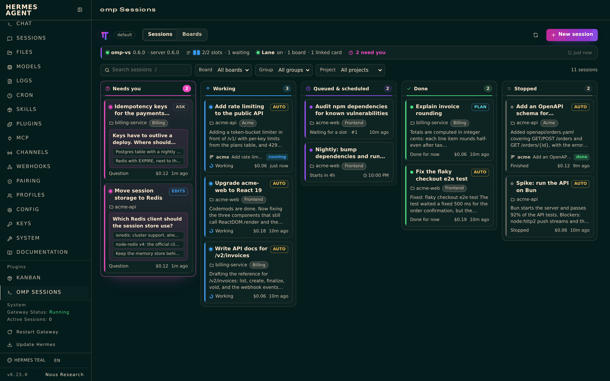

# switchyard: coding agent sessions for Hermes

Hermes hands coding work to coding agent sessions instead of doing it itself: [oh-my-pi](https://omp.sh) (`omp`), Claude Code, Codex or any other chat harness of [Agent Orchestrator](https://github.com/OrchestratorInc/agent-orchestrator) (AO), which runs every session, with queues, schedules and dependencies held by the [Switchyard](https://mbaradad.github.io/omp-sessions/) planner, so you can watch and steer it from the plugin's page in Hermes, a terminal (`switchyard attach`), AO's phone app, or VS Code.



- **Tools** (toolset `switchyard`, 16 tools): list sessions, projects and models; start a session now, queue it, or schedule it for later in a folder, a known project or a board's folder, optionally after other sessions; add to or reschedule a session's queue; check, wait on, answer, steer, switch the mode or model of, and stop a session; see how far parent sessions' changes reached their children, bring them in (or re-run a child with them); check AO and the Switchyard planner. Approval dialogs stay with people unless `agent_approvals: true`.
- **Harnesses**: `switchyard_session_start` takes `harness` (`claude-code`, `codex`, `omp`, …; `switchyard harnesses` lists them), and each board can set one (`hermes switchyard board <slug> --harness <id>`, `""` clears it). Without one: Switchyard's default, the AO project's worker harness, else AO's default. Plan mode, approval gating through Switchyard's omp extension and `/undo` are omp-only; on other harnesses `ask`/`edits`/`auto` map to AO's `default`/`accept-edits`/`bypass-permissions`. Page cards show the harness when it isn't omp.
- **Notifications**: when a session a Hermes chat started finishes or needs input, that chat gets a message.
- **Kanban lane**: cards assigned to `switchyard` run as coding agent sessions (one group per board, optional model and harness per board); the reply becomes the card's result, a question blocks the card until answered, a crash or reboot mid-task blocks it until you unblock it, and dependent cards chain as usual: a child card's session starts from its parents' work and gets their later changes (a merge conflict blocks the card). Comments from trusted authors (`lane.comment_authors`, default `dashboard`: the dashboard and Hermes Console) answer the agent's questions or reach its session, and `@switchyard` in such a comment hands a card to the lane. Approvals are never answered by comments. With `lane.archive_completed` on, a card the lane completes is archived with its session; `hermes switchyard archive-done` archives a board's done cards in one go.
- **Dashboard and Desktop page**: a live board of sessions (needs you, working, queued and scheduled, done, stopped; a chip names the harness when it isn't omp) with answers, follow-ups, mode and model switches, queue controls, mark completed, archive and unarchive (and *Archive all* on the Done column), new sessions, a bell for finish and needs-you sounds, and buttons to open a session or its project in VS Code, plus the lane's boards and linked cards and a dependency graph of each board's cards (coloured by status, with the state of their sessions). In the web dashboard it's the **Switchyard** tab; in Hermes Desktop, turn it on under Capabilities → Plugins (Desktop in remote mode: add it there with *Install from Git* first).
- **Skill** `switchyard:switchyard`, `/switchyard` in chats (`/switchyard take <card>` hands a kanban card to omp, also from Hermes Console on Android) and `hermes switchyard …` in a terminal.

## Requirements

- Hermes Agent 0.23.0 or later.
- `switchyard` on `PATH`, in `~/.local/bin`, or in `%LOCALAPPDATA%\switchyard` on Windows: run **Switchyard: Install switchyard Command** in the Switchyard VS Code extension, or install the standalone package attached to each [release](https://github.com/mbaradad/omp-sessions/releases) (`npm install -g <switchyard-<version>.tgz URL>`). omp itself must be installed and signed in. A gateway started by systemd or launchd may have a minimal `PATH`; the installed command works there because it records the absolute path of its runtime.

## Install

```sh
hermes plugins install mbaradad/omp-sessions/integrations/hermes/switchyard --enable
hermes config set plugins.entries.switchyard.allow_gateway_injection true   # lets notifications reach chats
```

Or from VS Code: **Switchyard: Install Hermes Plugin…** (or `switchyard hermes install --all-profiles`). Turn the kanban lane on in one profile: `hermes switchyard lane on`. Full guide: [docs/HERMES.md](https://github.com/mbaradad/omp-sessions/blob/main/docs/HERMES.md).

## What it does on your machine

- **Runs a local command.** Every tool call, page refresh and lane tick runs `switchyard` (`--json` subcommands) as your user, with free text passed after `--` or on stdin, never through a shell. On Windows it runs `node cli.js` directly rather than a `.cmd` shim. switchyard talks to the local AO daemon (HTTP on the loopback interface) and to the Switchyard planner (a Unix socket); the plugin makes no network calls of its own.
- **Starts coding agents.** Sessions run omp or another AO harness, which reads and edits files in the session's folder and runs commands there according to its permission mode (`ask`, `edits`, `plan` or `auto`; `plan` is omp-only). Lane cards use the board's mode, else the harness's default. The agent uses your own model provider sign-in and bills it.
- **Keeps state** in the profile's plugin data (which chat to notify about which session) and, for the lane, in `<kanban home>/plugin-data/switchyard-lane/` (card ↔ session links and a lock), next to Hermes's shared kanban boards.
- **Reads** Hermes's kanban boards through `hermes_cli.kanban_db` to claim, comment on, complete and block cards assigned to `switchyard`, and the skill files a card names so their paths can be passed to omp.
- No credentials are read or stored, nothing is downloaded, no telemetry.

## License

MIT
